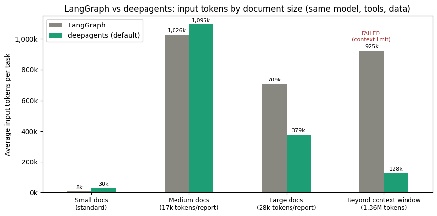

# deepagents vs LangGraph: when does the harness pay off?

**Question:** a plain LangGraph ReAct agent and a [deepagents](https://github.com/langchain-ai/deepagents) agent get the same model, the same tools and the same data. Where is the deepagents harness actually beneficial, and why?

**Short answer:**

- **Small documents:** both agents were 8/8 correct, but deepagents used **3.6× more input tokens** (about 2× the cost).
- **Large documents:** its context management (automatic offloading of large tool results plus file search) used **1.9× fewer tokens** than LangGraph across 3 runs, at about 36% lower cost.
- **Beyond the context window:** when the documents were bigger than the model's 1M-token context window, **LangGraph failed** with a context-limit error and **deepagents answered correctly in 3 of 3 runs**, using about 128k tokens.
- **Custom sub-agents** were not a reliable win: token use varied a lot from run to run, and they were slower.

## Setup (identical for both agents)

| | |
|---|---|
| Model | `gemini-3.8-flash`, temperature 0, same object for both agents |
| Tools | `list_reports()`, `read_report(name)` |
| System prompt | Same text for both: pricing-analyst role, read the methodology first, end with a machine-checkable `FINAL ANSWER:` line |
| Step limit | `recursion_limit=100` for both |
| LangGraph agent | Hand-built ReAct graph: `MessagesState`, agent node (LLM with bound tools), `ToolNode`, a conditional edge (tool call → tools, otherwise END) and a loop back to the agent |
| deepagents agent | `create_deep_agent(model, tools, system_prompt, middleware=[TodoListMiddleware()])` with deepagents 0.7.34. Planning (`write_todos`) is opt-in since 0.7. The filesystem (with automatic offloading of tool results over about 20k tokens), the `task` sub-agent tool and summarisation are built in. |
| deepagents + helper | The same setup plus one declared sub-agent, `country-analyst`, which reads one country report and returns only the Xelora figures. The main agent gets `list_reports` and `read_methodology` but not `read_report`, so document reading must be delegated. |

## Benchmark

**Data.** Synthetic pricing reports for a fictional drug, *Xelora*. Each country report gives the launch and month-12 price to wholesaler (PTW) and the price to hospital (PTH), plus that country's distribution rules: wholesaler and pharmacy margins (some capped or tiered), and VAT. Together these define the chain PTW → PTC → PTP → PTP VAT. The data is synthetic, so every correct answer is computed by code (`answer_key.json`). The reports include deliberate traps: margin caps, a tier that switches between launch and month 12, a reverse (share-of-final-price) margin rule, currency conversion, and distractor prices.

**Tasks.** There are 8 tasks of increasing difficulty: T1–T3 need one country, and T4–T8 need all 8 countries. T8 (the hardest) asks for price erosion at two price levels for all 8 countries, plus the reason for any gap.

**Document-size tiers.** The same Xelora facts are padded with realistic noise (other products' price tables, HTA history and tender notes):

| Tier | Report size | Total | Purpose |
|---|---|---|---|
| Standard | about 0.1k tokens each | about 6k | normal tasks |
| Medium (stress v1) | about 17k tokens each | about 134k | just *below* deepagents' 20k-token offload threshold |
| Large (stress v2) | about 28k tokens each | about 224k | just *above* the threshold |
| Beyond window (scale) | about 136k tokens each, 10 markets | about **1.36M** | more than Gemini's 1,048,576-token input limit |

**Grading and metrics.** A deterministic rule-based grader compares the `FINAL ANSWER:` line with the answer key: numbers within ±0.01, country sets, and ranking order. For every run I recorded:

- input and output tokens, using LangChain's usage callback, which also counts sub-agent calls (checked against per-message usage)
- wall time
- tool calls, by name
- errors

Cost uses Gemini 3.8 Flash list prices ($0.75 per million input tokens, $3.75 per million output tokens, with thinking billed as output). The token-based estimate came within about 10% of the actual bill.

## Results

| Scenario | Agent | Runs | Correct | Avg input tokens | Avg cost (₹) | Avg time (s) |
|---|---|---|---|---|---|---|
| Small docs (standard, 8 tasks) | LangGraph | 8 | 8/8 | **8,419** | **2.3** | **40.6** |
| | deepagents | 8 | 8/8 | 30,222 | 4.7 | 54.9 |
| Medium docs (17k/report, T8) | LangGraph | 2 | 2/2 | 1,026,194 | 79.2 | **135.8** |
| | deepagents | 1 | 1/1 | 1,095,466 | 84.3 | 144.7 |
| | deepagents + helper | 2 | 2/2 | 1,182,826 | 113.4 | 588.5 |
| Large docs (28k/report, T7+T8) | LangGraph | 3 | 3/3 | 708,697 | 55.3 | **105.0** |
| | deepagents | 3 | 3/3 | **378,897** | **35.1** | 181.6 |
| | deepagents + helper | 1 | 1/1 | 1,061,654 | 95.0 | 416.0 |
| **Beyond context window (1.36M)** | **LangGraph** | 1 | **0/1: context-limit error** | 924,796 (spent before failing) | 65.5 | 36.2 |
| | **deepagents** | 3 | **3/3** | **127,539** | **11.1** | 61.1 |
| | deepagents + helper | 1 | 1/1 | 2,148,689 | 166.7 | 238.0 |

The LangGraph error on the scale test was: `400 INVALID_ARGUMENT: The input token count exceeds the maximum number of tokens allowed 1048576.`

Full per-run data is in `results_all.csv` and the summary is in `scorecard.csv`.

## Findings

1. **On small tasks the harness is overhead.** Accuracy was the same, but deepagents' long built-in system prompt is resent on every call, costing 3.6× the input tokens. The model planned only once and never delegated.
2. **Offloading has a threshold.** At 17k tokens per report (below deepagents' 20k-token eviction limit), default deepagents kept every report in context and behaved like LangGraph (1.10M vs 1.03M tokens). At 28k per report, each tool result was offloaded to the virtual filesystem and the agent read only the relevant section with `read_file` and `grep`. On that same large-document data, it used 1.9× fewer tokens than LangGraph.
3. **Offloading removes the context-window ceiling.** LangGraph keeps every tool result in its message history, so its context grows with the total document size until the model rejects the request. deepagents' working context stayed around 130k tokens while it processed 1.36M tokens of documents. This is the clearest benefit of the harness: it completed a task the plain loop could not.
4. **Planning gets expensive in long contexts.** Each `write_todos` update is a full model call. When large documents were in context (medium tier), plan updates multiplied the cost.
5. **Custom sub-agents were not reliable here.**
   - **Medium tier:** the helper used 646k and then 1.72M tokens in two runs. The difference came from re-delegation (11 and 17 `task` calls for 8 countries). It was 4× slower than LangGraph because the helpers ran one after another.
   - **Large and scale tiers:** each helper's own report was offloaded too, so offloading and delegation overlapped and costs rose (up to 2.15M tokens).
   - The default "general-purpose" sub-agent was never used by the model on its own.
6. **Speed.** LangGraph was the fastest setup in every tier (its loop is simpler). The harness trades latency for context efficiency.

**When to use which:** a plain LangGraph loop for short tasks and small inputs. deepagents when tool results are large or the total material can exceed the context window. Sub-agents only when each sub-task needs substantial independent work, not a simple lookup.

## Limitations

- One model (Gemini 3.8 Flash, 1M-token window). With a smaller-window model, the gaps would likely appear earlier.
- Few runs per configuration (1–3; the standard tier has 8 tasks × 1 run). Agent behaviour varied between runs: the same LangGraph task used 567k and 992k tokens depending on how it batched tool calls. Averages and ranges over more runs would be stronger.
- The stress and scale tiers use the hardest tasks only (T7, T8, and one scale question S1).
- The grader is rule-based. Every completed run was graded correct; the only failure was LangGraph's context-limit error.
- Planning was used but not isolated with an on/off ablation. Summarisation never triggered.
- The data is synthetic and simplified. The margin rules are illustrative, not real country rules.

## Next steps

- Ablate planning (`TodoListMiddleware` on/off) and repeat each configuration 3–5 times.
- Give sub-agents heavier per-country work (the full price-chain calculation, not just extraction), run them in parallel, and scale to more countries. That is where delegation and offloading should combine.
- Repeat with a smaller-context model, and test summarisation by forcing long multi-turn runs.

## Reproduce

Kaggle notebook (CPU is enough); add a Google AI Studio key as the Kaggle secret `GOOGLE_API_KEY`. Billing must be enabled, because the free tier allows about 20 requests per day. The full benchmark cost about ₹1,000 in API usage.

| File | Purpose |
|---|---|
| `deepagents_vs_langgraph.ipynb` | Agents, tools, measurement, grading and all runs |
| `task2_build_test_bench.py` | Standard reports + `answer_key.json` (answers computed by code) |
| `task2_build_stress_reports.py` / `_v2.py` | Medium (17k) and large (28k) report tiers |
| `task2_build_scale_test.py` | Beyond-window tier (10 × 136k tokens) + question S1 |
| `results*.csv`, `scorecard.csv`, `scorecard_tokens.png` | Raw runs, summary and chart |

Versions: langgraph 1.2.20, deepagents 0.7.34, langchain-google-genai 4.4.3.

## References

- LangGraph documentation: https://docs.langchain.com/oss/python/langgraph/overview
- deepagents documentation: https://docs.langchain.com/oss/python/deepagents/overview
- `create_deep_agent` reference: https://reference.langchain.com/python/deepagents/graph/create_deep_agent
- LangChain Academy, *Introduction to LangGraph* and *Introduction to Deep Agents*: https://academy.langchain.com
- Yao et al., 2022. *ReAct: Synergizing Reasoning and Acting in Language Models.* https://arxiv.org/abs/2210.03629
- Liu et al., 2023. *Lost in the Middle: How Language Models Use Long Contexts.* https://arxiv.org/abs/2307.03172
